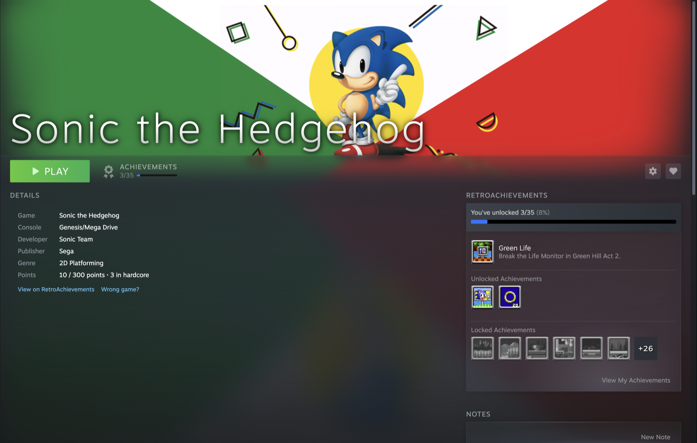
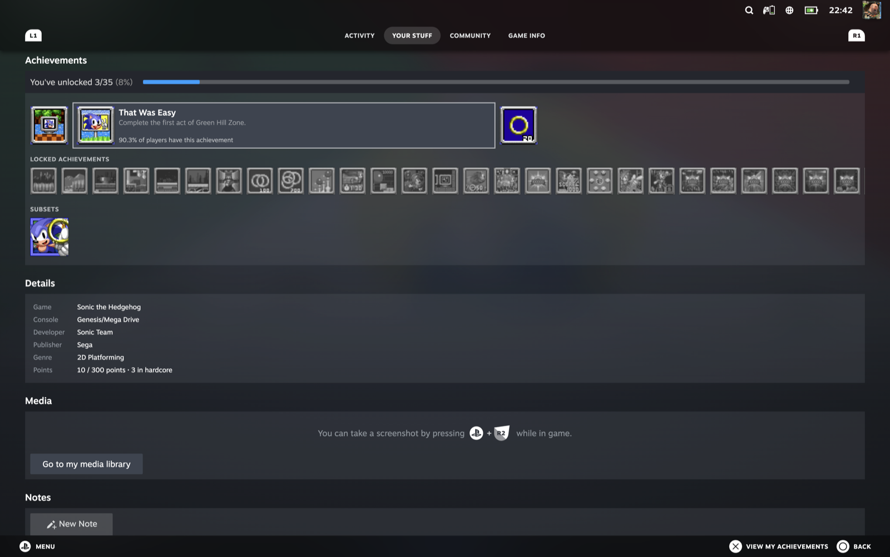
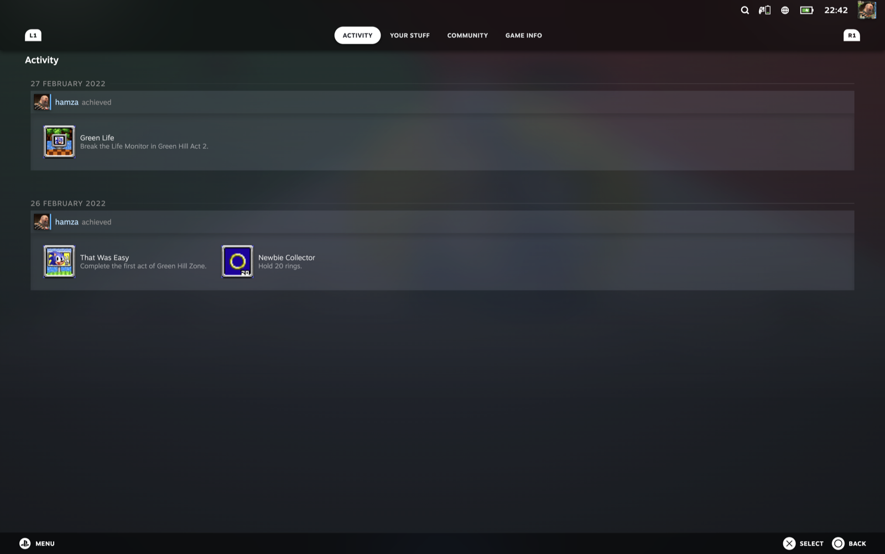
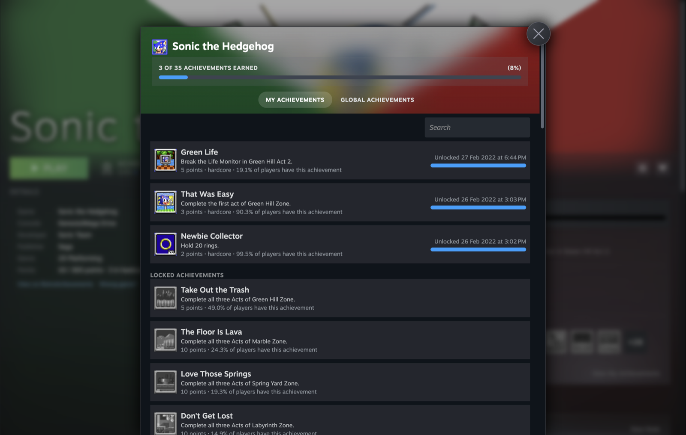
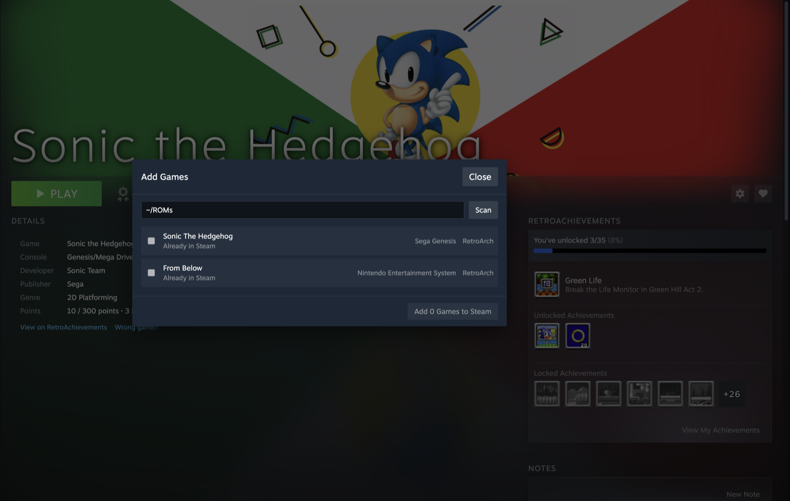

<p align="center">
  
  <h1 align="center">Steam RetroAchievements</h1>
  <p align="center">
    <strong>Your RetroAchievements inside Steam, looking just like a Steam game's achievements.</strong>
  </p>
  <p align="center">
    <a href="../../releases/latest"></a>
    
    
    
    
    <a href="LICENSE"></a>
  </p>
</p>

---

<p align="center">
  
</p>

You play your retro games through Steam, but their achievements live on a website. Steam shows a dashed box saying it knows nothing about the game.

**Steam RetroAchievements** fills that page in: your progress, your unlocks, the game's details and its full achievements list, drawn with Steam's own styles, in the desktop library and in Big Picture mode.

| Big Picture: Your Stuff | Big Picture: Activity |
|---|---|
|  |  |

| Achievements page | Add Games |
|---|---|
|  |  |

> Linux and Windows support is new. The Windows build has been run on Windows 11, where it connects to Steam and shows its buttons and sign-in dialog; signing in with a real account and the achievements panel on a game page haven't been checked there yet. The Linux build hasn't been run on a Linux machine yet.

---

## ⚡ Features

- **Achievements on the game page**: your progress bar, your latest unlock, and rows of unlocked and locked icons with hover cards. An **Achievements** stat sits in the play bar next to Play.
- **Achievements page**: **View My Achievements** opens Steam's achievements page with unlock dates, rarity, My and Global tabs, and search.
- **Activity feed**: your unlocks grouped by day ("you achieved…"), like a Steam game's.
- **Game details behind the (i) button**: box art, console, developer, publisher, genre and points.
- **Big Picture mode** with **full controller support**: the D-pad moves through the achievements like any Steam game, and **A** opens the achievements page.
- **Subsets** (Bonus, Time Attack…) each get an icon that opens their own achievements page.
- **Add Games**: scan a ROM folder, pick an emulator for each game, and add them all to Steam in one go.
- **Knows your exact ROM**: it fingerprints ROMs with RetroAchievements' own code and warns you when a version won't unlock achievements.
- Works with **RetroArch**, **DuckStation** (PS1), **PCSX2** (PS2), **PPSSPP** (PSP), **Dolphin** (GameCube/Wii), **Flycast** (Dreamcast) and **SkyEmu** (Game Boy family).
- **Stays out of the way**: a menu bar app on macOS, a tray icon on Windows, a background program on Linux. Signing in and adding games happen inside Steam.
- **Update notices** when a new version is out.

---

## 📥 Installation

1. Download your platform's file from the [**latest release**](../../releases/latest) and start the app:
   - **macOS:** unzip `steam-retroachievements-macos.zip`, drag **Steam RetroAchievements** into your **Applications** folder and open it. If macOS says it can't check the app for malicious software, go to **System Settings > Privacy & Security**, click **Open Anyway**, then **Open**. You only do this once.
   - **Windows:** unzip `steam-retroachievements-windows.zip` and run `SteamRetroAchievements.exe`. It shows a trophy in the notification area (the tray); click it to see the status or quit. Keep all the files in the folder together. If SmartScreen warns, choose **More info → Run anyway** (the program isn't signed).
   - **Linux:** unpack `steam-retroachievements-linux.tar.gz` and run `./steam-retroachievements` from a terminal. Keep `inject.js` and `icon.png` next to it. On a Steam Deck, do this in Desktop Mode. The first run also adds **Steam RetroAchievements** to your app menu, so after that you can start it from there.
2. **Restart Steam** if asked. Steam only reads the developer switch when it starts. On macOS, the menu bar shows **Restart Steam to finish setup** with a button. On Windows the tray menu says so, on Linux the terminal; quit Steam and open it again yourself.
3. When Steam connects, a **Steam RetroAchievements** dialog opens in Steam's library. Enter your RetroAchievements username and Web API key; the key is on [retroachievements.org/settings](https://retroachievements.org/settings). Click **Sign In**. Signing in also turns on **Open at login**: a login item on macOS, a systemd user service on Linux (it runs in Steam Deck's Game Mode too), a Run registry entry on Windows.
4. **Sign in to RetroAchievements inside each emulator** you play with. The emulator is what unlocks achievements; this app only shows them.

You can open the dialog again from the **RetroAchievements** button at the bottom of Steam's library, next to **Add a Game**.

Keep your ROMs in the `ROMs` folder in your home folder (`~/ROMs`), or EmuDeck's `~/Emulation/roms`. On macOS, background apps can't read the Desktop, Documents, Downloads, iCloud Drive, or external drives without extra permission.

**Why the downloads differ in size:** the macOS download is under 1 MB because macOS already includes Swift and the libraries the app uses. Linux and Windows don't, so their downloads (about 25 MB each) carry them along: the Swift runtime, Foundation, networking, and Unicode data (ICU), which is the largest part. The Linux program has them built in; on Windows they're the DLL files next to the `.exe`, which is why every file in that folder has to stay together.

---

## 🎮 Adding Games to Steam

You can add games any of these ways:

- **Add Games dialog:** click the **Add Games** button next to Steam's own "Add a Game" (or **Add Games…** in the macOS menu bar). It scans a folder, using one subfolder per console (`snes`, `psx`, `gba`, …), picks an installed emulator for each game, and adds the games to Steam in one go.
  - On Linux it finds emulators on your `PATH` (`retroarch`, `duckstation-qt`, `pcsx2-qt`, `PPSSPPSDL`, `dolphin-emu`, `flycast`, `SkyEmu`) and Flathub installs. It doesn't find AppImages unless they're on your `PATH` under those names.
  - On Windows it looks on your `PATH`, in `C:\RetroArch-Win64`, and in `Program Files` / `AppData\Local\Programs\<emulator>`.
- **Steam ROM Manager:** shortcuts it creates work as they are, as long as they launch the emulator directly rather than through a wrapper script. On macOS, with Steam ROM Manager closed, `scripts/srm-parsers.py` sets it up with one parser per console, reading the same `~/ROMs/<console>` folders and pulling artwork from SteamGridDB. Re-run it after downloading new RetroArch cores.
- **Steam's "Add a Non-Steam Game" (macOS):** pick the emulator app, then open the shortcut's **Properties**:
  - Set **Target** to `"/usr/bin/arch"`. Steam on macOS starts games as Intel apps, which can't load Apple Silicon cores; `arch -arm64` keeps the emulator native.
  - Set **Launch Options** to `-arm64 "<emulator executable>"` followed by the emulator's arguments:

  | Emulator | Launch Options |
  |---|---|
  | RetroArch | `-arm64 "/Applications/RetroArch.app/Contents/MacOS/RetroArch" -L "/Users/<you>/Library/Application Support/RetroArch/cores/<core>_libretro.dylib" "/Users/<you>/ROMs/<console>/<game file>"` |
  | DuckStation, PCSX2 | `-arm64 "<emulator executable>" -batch -- "/Users/<you>/ROMs/<console>/<game file>"` |
  | Dolphin | `-arm64 "<emulator executable>" -b -e "/Users/<you>/ROMs/<console>/<game file>"` |
  | PPSSPP, Flycast, SkyEmu | `-arm64 "<emulator executable>" "/Users/<you>/ROMs/<console>/<game file>"` |

  The emulator executable is inside its app, for example `/Applications/DuckStation.app/Contents/MacOS/DuckStation`.

A shortcut with no ROM in its launch options just opens the emulator's menu, so it gets no panel.

---

## 🩺 When Something Looks Wrong

- **"Couldn't check this ROM version":** the app can't fingerprint `.chd` or `.7z` files yet. It matched the game by name. Your emulator can still unlock achievements.
- **"RetroAchievements doesn't recognize this ROM version":** this exact ROM isn't one RetroAchievements supports, so the emulator won't unlock achievements for it.
- **Subsets:** when a game has RetroAchievements subsets (Bonus, Time Attack…), the achievements panel shows an icon for each under "Subsets". Click one (in Big Picture, press A on it) to open that subset's achievements page. Subsets are separate from the game's own list and totals.
- **Wrong game:** in the desktop library, click the (i) button next to the heart, then **Wrong game?**, and pick the right one. The app remembers your choice.
- **Panel gone after a Steam update:** restart Steam (macOS: **Restart Steam** in the menu bar). If it's still missing, Steam changed something inside and the app needs an update.
- **Log file:** `~/Library/Logs/steam-retroachievements.log` on macOS, `~/.local/share/steam-retroachievements/steam-retroachievements.log` on Linux, `%LOCALAPPDATA%\steam-retroachievements\steam-retroachievements.log` on Windows.

---

## 🧹 Uninstalling

In Steam, open the **RetroAchievements** dialog, click **Uninstall…**, and confirm. This removes:
- the developer switch
- your saved sign-in
- cached data and the log
- open at login
- the app-menu entry (Linux)

On macOS it then moves the app to the Trash; on Linux and Windows, delete the program's folder yourself. Restart Steam afterwards. Games the app added stay in your library.

---

## 🔒 How It Works and Privacy

- The app turns on Steam's built-in developer switch: an empty file named `.cef-enable-remote-debugging` in Steam's install folder (inside Steam's app bundle on macOS, `~/.steam/steam` on Linux, the folder with `steam.exe` on Windows). With it, Steam lets local programs talk to its interface on `127.0.0.1:8080`.
- The app adds one small script to Steam's interface. The script draws the panel, and the app does everything else:
  - fingerprints your ROMs with RetroAchievements' own code (rcheevos)
  - talks to the RetroAchievements API
  - keeps your Web API key: in the macOS Keychain, on Linux in a file only your user account can read, or on Windows encrypted with your Windows account (DPAPI), so other users and other PCs can't read it. You type the key into a dialog inside Steam, so Steam's interface sees it once while you sign in.
- The app opens no network ports and never changes anything in your Steam account. It only adds library shortcuts when you ask it to.
- It goes online only to talk to RetroAchievements and to check GitHub for a newer release. No tracking, no analytics.

---

## 🛠️ Building (for Developers)

You need Apple's Command Line Tools (no Xcode required).

```bash
scripts/test.sh          # run the tests
scripts/build-app.sh     # build, sign ad-hoc, install to ~/Applications and open
scripts/build-linux.sh   # cross-build build/steam-retroachievements-linux.tar.gz (x86_64)
node scripts/steam-eval.mjs 'MainWindowBrowserManager.m_lastLocation'   # poke at Steam's UI
```

`build-linux.sh` needs the swift.org toolchain from [swiftly](https://www.swift.org/install/macos/) and the matching Static Linux SDK (`swift sdk install <bundle URL> --checksum <sum>`, both listed on swift.org). For ARM Linux, run it with `SDK=aarch64-swift-linux-musl`.

**Releases:** publishing a GitHub release runs `.github/workflows/macos.yml`, `linux.yml` and `windows.yml`, which build each platform's file and attach it to the release (or run one by hand with a tag).

**Windows:** to build on Windows yourself with the Swift toolchain (the linker flags make it a windowless program, so no console opens at login):

```bash
rc.exe /fo .build\AppIcon.res Resources\AppIcon.rc
swift build -c release --product SteamRetroAchievements -Xlinker /SUBSYSTEM:WINDOWS -Xlinker /ENTRY:mainCRTStartup -Xlinker .build\AppIcon.res
```

`rc.exe` comes with the Windows SDK that the Swift toolchain already needs; the first line puts the icon on the `.exe`. Copy `.build\release\SteamRetroAchievements.exe` and `steam\inject.js` into one folder.

The icons come from `scripts/make-icon.swift` (`swift scripts/make-icon.swift`), which writes the macOS `.icns`, the Windows `.ico` and `docs/icon.png`.

`docs/steam-internals.md` records what was verified about Steam's interface on macOS. Read it first when a Steam update breaks something.

---

## 📄 License

Steam RetroAchievements is free and open source under the [MIT License](LICENSE). It includes [rcheevos](https://github.com/RetroAchievements/rcheevos), also MIT licensed; see [THIRD_PARTY_NOTICES.md](THIRD_PARTY_NOTICES.md).

---

<sub>Not affiliated with or endorsed by Valve or RetroAchievements. Steam is a trademark of Valve Corporation.</sub>
